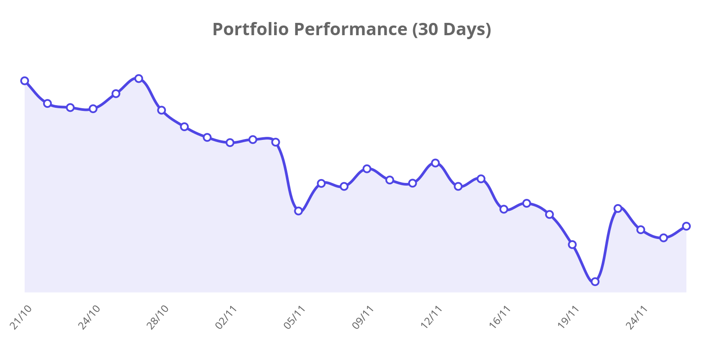

# 📈 Stock Tracker & Portfolio Analytics | מעקב תיק השקעות

> **מערכת חכמה לניהול ומעקב תיק השקעות בזמן אמת.**
> כוללת חישובי מס רווחי הון (25% ללא קיזוז הפסדים), המרות מט"ח דינמיות, יומן דיבידנדים היסטורי וניתוח ביצועים מתקדם.
> 👉 **[למעבר לדשבורד המלא והאינטראקטיבי לחץ כאן](https://almog787.github.io/My-new-stock-trucker/)**

---

## 📊 תמונת מצב (Executive Snapshot)

* **שווי תיק נוכחי:** `₪171,723` (`$52,329`)
* **רווח כולל נטו (לאחר 25% מס ללא קיזוז הפסדים):** `+₪21,199` (**+14.90%**)
* **שינוי יומי:** `-₪225` (**-0.13%**)
* **תוספת חודשית ממוצעת (YTD):** `-₪905/חודש` נטו
* **סך דיבידנדים (12M):** `₪729` נטו
* **מועד עדכון אחרון:** `18/11/2026 14:45` (שער ברוקר: `₪3.282`)

---

## 📋 ביצועי מניות והחזקות (Holdings Performance)

| נכס (Asset) | כמות | שער נוכחי | שווי שוק | שינוי יומי (Daily Change) | שינוי מהכניסה לתיק (Total Return) |
| :--- | :---: | :---: | :---: | :---: | :---: |
| **GOOGL**  Alphabet (Google) | 48 | $281.78 | ₪44,385  ($13,525) | 🟢 +0.56%  +₪249 | 🟢 +49.89%  +₪14,774 |
| **ASML**  ASML Holding | 4 | $1371.54 | ₪18,003  ($5,486) | 🔴 -0.84%  -₪152 | 🟢 +46.77%  +₪5,737 |
| **XOM**  Exxon Mobil | 2 | $162.68 | ₪1,068  ($325) | 🔴 -2.72%  -₪30 | 🟢 +29.03%  +₪240 |
| **NVDA**  NVIDIA Corp | 60 | $154.11 | ₪30,344  ($9,247) | 🔴 -0.87%  -₪266 | 🟢 +3.32%  +₪975 |
| **TSLA**  Tesla Inc | 20 | $381.50 | ₪25,039  ($7,630) | 🟢 +0.37%  +₪91 | 🔴 -12.59%  -₪3,606 |
| **VOO**  Vanguard S&P 500 | 24 | $671.48 | ₪52,885  ($16,116) | 🔴 -0.22%  -₪117 | 🟢 +27.32%  +₪11,349 |

---

## 📈 גרפים ומגמות (Visual Analytics)

### 📊 תנועת מניות התיק (שבועית ודו-שבועית כולל ציון סופי שבוע)
> **מעקב רציף אחר ביצועי כל מניות התיק בחתך שבועי (7 ימים) ודו-שבועי (14 ימים), עם ציון והדגשה ברורה של סופי השבוע (שבת וראשון שבהם המסחר סגור בבורסות ארה"ב).**

#### 🗓️ תנועת מניות שבועית (שבוע מסחר אחרון)

#### 📅 תנועת מניות דו-שבועית (14 ימי מסחר)

### 📊 ביצועי תיק והקצאת נכסים (30 יום)

 

> 💡 *לפירוט החזקות מלא, ניתוח תשואות חודשי, יומן דיבידנדים וגרפים אינטראקטיביים, יש להיכנס ל-[דשבורד המערכת](https://almog787.github.io/My-new-stock-trucker/).*

---
📂 *Portfolio Tracker & Analytics Engine by Almog787*
