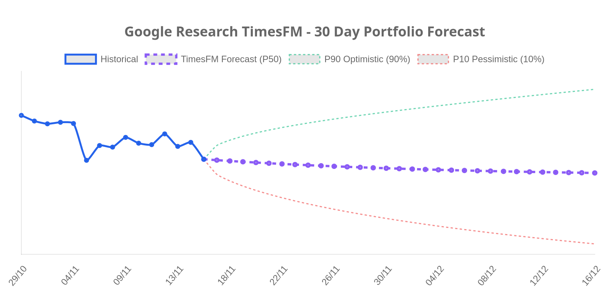

# 📈 Stock Tracker & Portfolio Analytics | מעקב תיק השקעות

> **מערכת חכמה לניהול ומעקב תיק השקעות בזמן אמת המשולבת במודל חיזוי סדרות עתיות Google Research TimesFM.** 
> כוללת חישובי מס רווחי הון (25%), המרות מט"ח, יומן דיבידנדים היסטורי, מנוע זיהוי אנומליות וחיזוי מבוסס AI.
> 👉 **[למעבר לדשבורד המלא והאינטראקטיבי לחץ כאן](https://almog787.github.io/My-new-stock-trucker/)**

---

## 📊 תמונת מצב (Executive Snapshot)

* **שווי תיק נוכחי:** `₪169,063` (`$51,936`)
* **רווח כולל נטו (לאחר 25% מס ללא קיזוז הפסדים):** `+₪21,215` (**+15.20%**)
* **שינוי יומי:** `-₪1,510` (**-0.89%**)
* **תוספת חודשית ממוצעת (YTD):** `-₪856/חודש` נטו
* **סך דיבידנדים (12M):** `₪719` נטו
* **מועד עדכון אחרון:** `17/11/2026 21:42` (שער ברוקר: `₪3.255`)

---

## 📋 ביצועי מניות והחזקות (Holdings Performance)

| נכס (Asset) | כמות | שער נוכחי | שווי שוק | שינוי יומי (Daily Change) | שינוי מהכניסה לתיק (Total Return) |
| :--- | :---: | :---: | :---: | :---: | :---: |
| **GOOGL**  Alphabet (Google) | 48 | $280.20 | ₪43,781  ($13,450) | 🔴 -1.24%  -₪550 | 🟢 +49.05%  +₪14,408 |
| **ASML**  ASML Holding | 4 | $1383.11 | ₪18,009  ($5,532) | 🔴 -1.68%  -₪308 | 🟢 +48.00%  +₪5,841 |
| **XOM**  Exxon Mobil | 2 | $167.21 | ₪1,089  ($334) | 🟢 +0.20%  +₪2 | 🟢 +32.62%  +₪268 |
| **NVDA**  NVIDIA Corp | 57 | $155.46 | ₪28,845  ($8,861) | 🔴 -0.44%  -₪126 | 🟢 +4.60%  +₪1,269 |
| **TSLA**  Tesla Inc | 20 | $380.11 | ₪24,747  ($7,602) | 🟢 +0.10%  +₪24 | 🔴 -12.91%  -₪3,668 |
| **VOO**  Vanguard S&P 500 | 24 | $673.19 | ₪52,593  ($16,157) | 🔴 -1.04%  -₪552 | 🟢 +27.65%  +₪11,391 |

---

## 🔮 תחזיות מודל Google Research TimesFM (AI Forecasting & Analytics)

* **יעד שווי תיק צפוי בעוד 30 יום (P50):** `₪164,899` (`$50,274`)
* **טווח הסתברותי (P10 - P90):** `₪132,212` עד `₪205,047`
* **תשואת תיק צפויה (30d Expected Return):** `-3.20%` (תנודתיות שנתית חזויה: `29.0%`)
* **תחזית שער דולר/שקל (30 יום):** `₪3.280` (טווח: `₪3.100 - ₪3.460`)

### 🎯 מטריצת תחזיות ואותות למניות התיק:
| מניה (Asset) | שער נוכחי | יעד צפוי 30 יום (P50) | טווח ביטחון (P10 - P90) | תשואה חזויה | אות מודל (AI Signal) |
| :--- | :---: | :---: | :---: | :---: | :---: |
| **GOOGL** | `$280.20` | `$266.64` | `$214.35 - $331.69` | **-4.84%** | 🔴 תיקון יורד (Bearish) |
| **ASML** | `$1383.11` | `$1333.13` | `$1017.75 - $1746.25` | **-3.61%** | 🔴 תיקון יורד (Bearish) |
| **XOM** | `$167.21` | `$168.03` | `$145.02 - $194.69` | **+0.49%** | 🟢 דשדוש / ניטרלי |
| **NVDA** | `$155.46` | `$143.83` | `$109.99 - $188.09` | **-7.48%** | 🔴 תיקון יורד (Bearish) |
| **TSLA** | `$380.11` | `$385.08` | `$289.44 - $512.33` | **+1.31%** | 🟢 מגמה חיובית מתונה |
| **VOO** | `$673.19` | `$667.82` | `$603.98 - $738.40` | **-0.80%** | 🔴 דשדוש / ניטרלי |

---

## 📈 גרפים ומגמות (Visual Analytics)

### 📊 תנועת מניות התיק (שבועית ודו-שבועית כולל ציון סופי שבוע)
> **מעקב רציף אחר ביצועי כל מניות התיק בחתך שבועי (7 ימים) ודו-שבועי (14 ימים), עם ציון והדגשה ברורה של סופי השבוע (שבת וראשון שבהם המסחר סגור בבורסות ארה"ב).**

#### 🗓️ תנועת מניות שבועית (שבוע מסחר אחרון)

#### 📅 תנועת מניות דו-שבועית (14 ימי מסחר)

### 🔮 תחזית ביצועים והקצאת נכסים

 

 

> 💡 *לפירוט החזקות מלא, סימולטור תרחישים, זיהוי אנומליות וגרפים אינטראקטיביים, יש להיכנס ל-[דשבורד המערכת](https://almog787.github.io/My-new-stock-trucker/).*

---
📂 *Portfolio Tracker Engine & TimesFM AI Analytics by Almog787*
