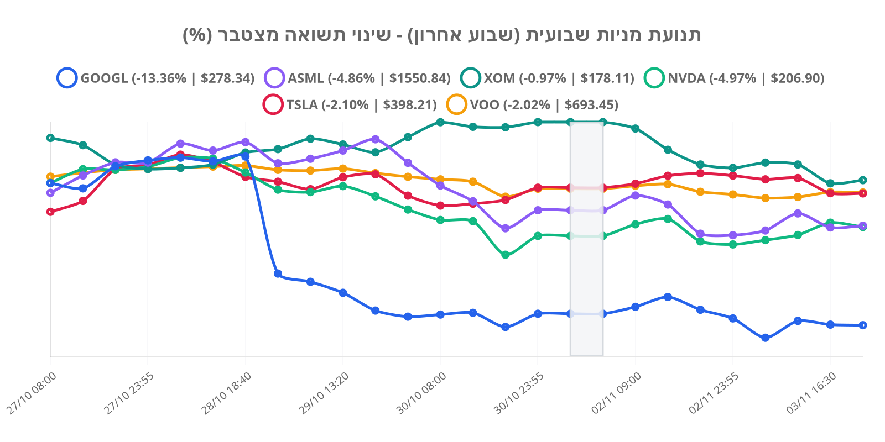
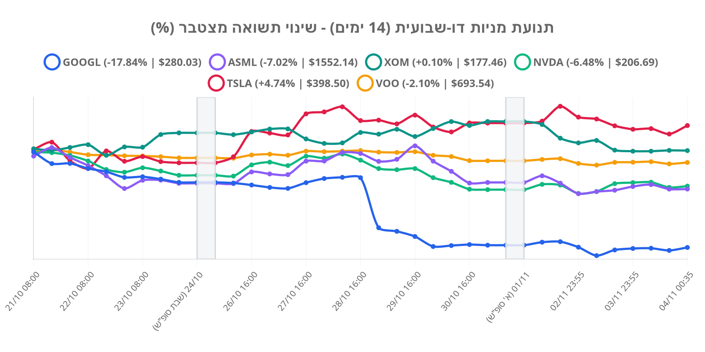
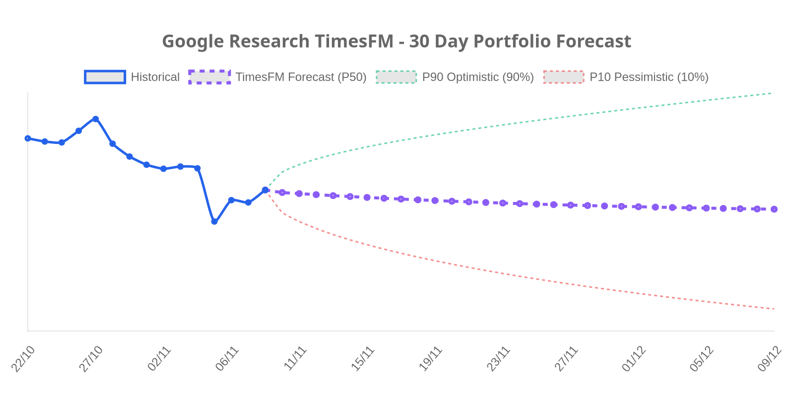
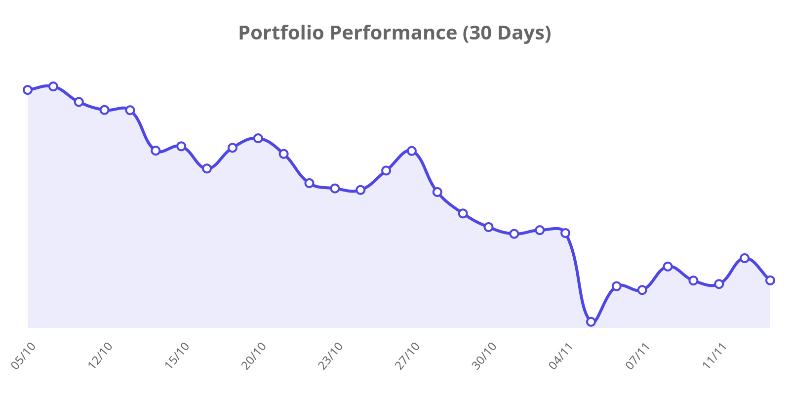
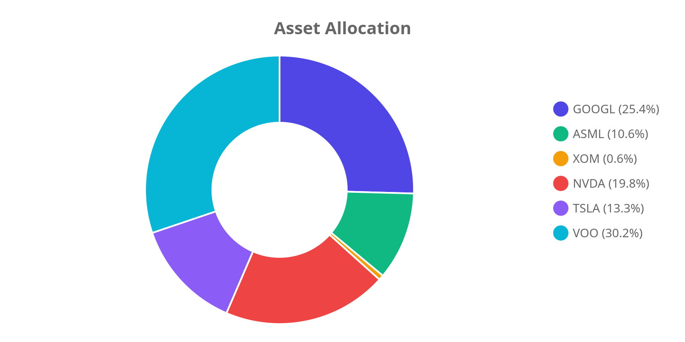

# 📈 Stock Tracker & Portfolio Analytics | מעקב תיק השקעות

> **מערכת חכמה לניהול ומעקב תיק השקעות בזמן אמת המשולבת במודל חיזוי סדרות עתיות Google Research TimesFM.** 
> כוללת חישובי מס רווחי הון (25%), המרות מט"ח, יומן דיבידנדים היסטורי, מנוע זיהוי אנומליות וחיזוי מבוסס AI.
> 👉 **[למעבר לדשבורד המלא והאינטראקטיבי לחץ כאן](https://almog787.github.io/My-new-stock-trucker/)**

---

## 📊 תמונת מצב (Executive Snapshot)

* **שווי תיק נוכחי:** `₪172,591` (`$54,564`)
* **רווח כולל נטו (לאחר 25% מס):** `+₪26,815` (**+19.77%**)
* **שינוי יומי:** `+₪2,647` (**+1.56%**)
* **הכנסה פאסיבית חודשית ממוצעת (YTD):** `+₪76/חודש` נטו
* **סך דיבידנדים (12M):** `₪699` נטו
* **מועד עדכון אחרון:** `09/11/2026 23:06` (שער רציף: `₪3.163`)

---

## 📋 ביצועי מניות והחזקות (Holdings Performance)

| נכס (Asset) | כמות | שער נוכחי | שווי שוק | שינוי יומי (Daily Change) | שינוי מהכניסה לתיק (Total Return) |
| :--- | :---: | :---: | :---: | :---: | :---: |
| **GOOGL**  Alphabet (Google) | 48 | $288.15 | ₪43,749  ($13,831) | 🟢 +1.18%  +₪512 | 🟢 +53.28%  +₪15,207 |
| **ASML**  ASML Holding | 4 | $1513.25 | ₪19,146  ($6,053) | 🟢 +6.21%  +₪1,120 | 🟢 +61.93%  +₪7,322 |
| **XOM**  Exxon Mobil | 2 | $164.73 | ₪1,042  ($329) | 🔴 -0.69%  ₪-7 | 🟢 +30.66%  +₪245 |
| **NVDA**  NVIDIA Corp | 57 | $178.67 | ₪32,214  ($10,184) | 🔴 -4.27%  ₪-1,437 | 🟢 +20.22%  +₪5,418 |
| **TSLA**  Tesla Inc | 20 | $378.05 | ₪23,916  ($7,561) | 🟢 +5.54%  +₪1,254 | 🔴 -13.38%  ₪-3,695 |
| **VOO**  Vanguard S&P 500 | 24 | $691.87 | ₪52,523  ($16,605) | 🟢 +2.35%  +₪1,206 | 🟢 +31.19%  +₪12,487 |

---

## 🔮 תחזיות מודל Google Research TimesFM (AI Forecasting & Analytics)

* **יעד שווי תיק צפוי בעוד 30 יום (P50):** `₪169,225` (`$53,215`)
* **טווח הסתברותי (P10 - P90):** `₪137,504` עד `₪208,289`
* **תשואת תיק צפויה (30d Expected Return):** `-2.47%` (תנודתיות שנתית חזויה: `26.9%`)
* **תחזית שער דולר/שקל (30 יום):** `₪3.180` (טווח: `₪3.010 - ₪3.360`)

### 🎯 מטריצת תחזיות ואותות למניות התיק:
| מניה (Asset) | שער נוכחי | יעד צפוי 30 יום (P50) | טווח ביטחון (P10 - P90) | תשואה חזויה | אות מודל (AI Signal) |
| :--- | :---: | :---: | :---: | :---: | :---: |
| **GOOGL** | `$288.15` | `$277.35` | `$224.31 - $342.93` | **-3.75%** | 🔴 תיקון יורד (Bearish) |
| **ASML** | `$1513.25` | `$1468.98` | `$1111.43 - $1941.54` | **-2.93%** | 🔴 תיקון יורד (Bearish) |
| **XOM** | `$164.73` | `$166.00` | `$142.07 - $193.97` | **+0.77%** | 🟢 מגמה חיובית מתונה |
| **NVDA** | `$178.67` | `$168.21` | `$132.95 - $212.83` | **-5.85%** | 🔴 תיקון יורד (Bearish) |
| **TSLA** | `$378.05` | `$383.97` | `$290.16 - $508.13` | **+1.57%** | 🟢 מגמה חיובית מתונה |
| **VOO** | `$691.87` | `$688.09` | `$625.83 - $756.55` | **-0.55%** | 🔴 דשדוש / ניטרלי |

---

## 📈 גרפים ומגמות (Visual Analytics)

### 📊 תנועת מניות התיק (שבועית ודו-שבועית כולל ציון סופי שבוע)
> **מעקב רציף אחר ביצועי כל מניות התיק בחתך שבועי (7 ימים) ודו-שבועי (14 ימים), עם ציון והדגשה ברורה של סופי השבוע (שבת וראשון שבהם המסחר סגור בבורסות ארה"ב).**

#### 🗓️ תנועת מניות שבועית (שבוע מסחר אחרון)

#### 📅 תנועת מניות דו-שבועית (14 ימי מסחר)

### 🔮 תחזית ביצועים והקצאת נכסים

 

 

> 💡 *לפירוט החזקות מלא, סימולטור תרחישים, זיהוי אנומליות וגרפים אינטראקטיביים, יש להיכנס ל-[דשבורד המערכת](https://almog787.github.io/My-new-stock-trucker/).*

---
📂 *Portfolio Tracker Engine & TimesFM AI Analytics by Almog787*
