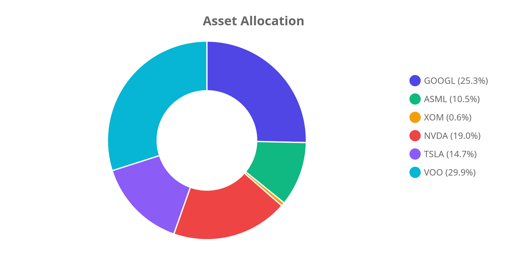

# 📈 Stock Tracker & Portfolio Analytics | מעקב תיק השקעות

> **מערכת חכמה לניהול ומעקב תיק השקעות בזמן אמת.**
> כוללת חישובי מס רווחי הון (25% ללא קיזוז הפסדים), המרות מט"ח דינמיות, יומן דיבידנדים היסטורי וניתוח ביצועים מתקדם.
> 👉 **[למעבר לדשבורד המלא והאינטראקטיבי לחץ כאן](https://almog787.github.io/My-new-stock-trucker/)**

---

## 📊 תמונת מצב (Executive Snapshot)

* **שווי תיק נוכחי:** `₪170,670` (`$51,461`)
* **רווח כולל נטו (לאחר 25% מס ללא קיזוז הפסדים):** `+₪19,126` (**+13.30%**)
* **שינוי יומי:** `-₪2,792` (**-1.61%**)
* **תוספת חודשית ממוצעת (YTD):** `-₪1,159/חודש` נטו
* **סך דיבידנדים (12M):** `₪737` נטו
* **מועד עדכון אחרון:** `19/11/2026 19:12` (שער ברוקר: `₪3.317`)

---

## 📋 ביצועי מניות והחזקות (Holdings Performance)

| נכס (Asset) | כמות | שער נוכחי | שווי שוק | שינוי יומי (Daily Change) | שינוי מהכניסה לתיק (Total Return) |
| :--- | :---: | :---: | :---: | :---: | :---: |
| **GOOGL**  Alphabet (Google) | 48 | $278.29 | ₪44,302  ($13,358) | 🔴 -1.47%  -₪661 | 🟢 +48.03%  +₪14,375 |
| **ASML**  ASML Holding | 4 | $1378.63 | ₪18,289  ($5,515) | 🔴 -1.19%  -₪221 | 🟢 +47.52%  +₪5,892 |
| **XOM**  Exxon Mobil | 2 | $158.88 | ₪1,054  ($318) | 🔴 -1.06%  -₪11 | 🟢 +26.02%  +₪218 |
| **NVDA**  NVIDIA Corp | 60 | $148.16 | ₪29,482  ($8,890) | 🔴 -1.85%  -₪557 | 🔴 -0.67%  -₪199 |
| **TSLA**  Tesla Inc | 20 | $376.15 | ₪24,950  ($7,523) | 🔴 -1.97%  -₪502 | 🔴 -13.82%  -₪4,000 |
| **VOO**  Vanguard S&P 500 | 24 | $660.75 | ₪52,593  ($15,858) | 🔴 -1.57%  -₪841 | 🟢 +25.29%  +₪10,616 |

---

## 📈 גרפים ומגמות (Visual Analytics)

### 📊 תנועת מניות התיק (שבועית ודו-שבועית כולל ציון סופי שבוע)
> **מעקב רציף אחר ביצועי כל מניות התיק בחתך שבועי (7 ימים) ודו-שבועי (14 ימים), עם ציון והדגשה ברורה של סופי השבוע (שבת וראשון שבהם המסחר סגור בבורסות ארה"ב).**

#### 🗓️ תנועת מניות שבועית (שבוע מסחר אחרון)

#### 📅 תנועת מניות דו-שבועית (14 ימי מסחר)

### 📊 ביצועי תיק והקצאת נכסים (30 יום)

 

> 💡 *לפירוט החזקות מלא, ניתוח תשואות חודשי, יומן דיבידנדים וגרפים אינטראקטיביים, יש להיכנס ל-[דשבורד המערכת](https://almog787.github.io/My-new-stock-trucker/).*

---
📂 *Portfolio Tracker & Analytics Engine by Almog787*
