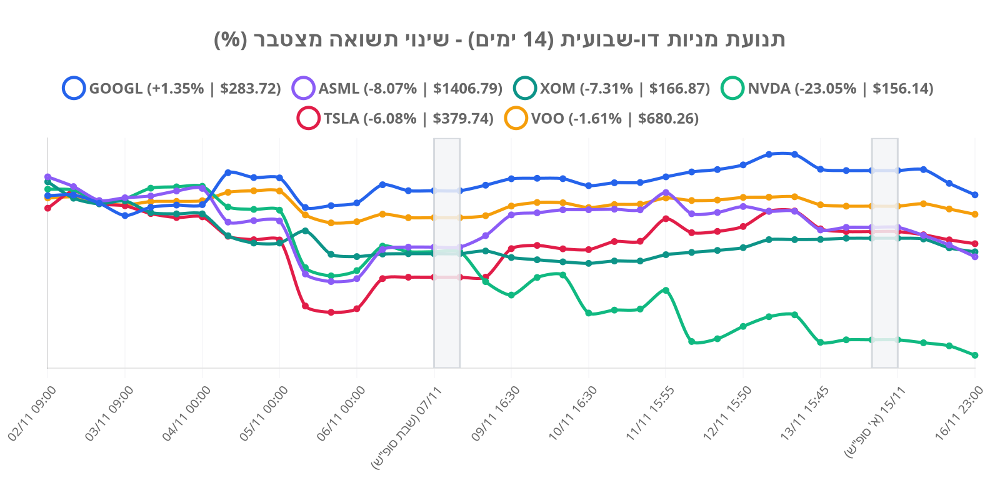

# 📈 Stock Tracker & Portfolio Analytics | מעקב תיק השקעות

> **מערכת חכמה לניהול ומעקב תיק השקעות בזמן אמת.**
> כוללת חישובי מס רווחי הון (25% ללא קיזוז הפסדים), המרות מט"ח דינמיות, יומן דיבידנדים היסטורי וניתוח ביצועים מתקדם.
> 👉 **[למעבר לדשבורד המלא והאינטראקטיבי לחץ כאן](https://almog787.github.io/My-new-stock-trucker/)**

---

## 📊 תמונת מצב (Executive Snapshot)

* **שווי תיק נוכחי:** `₪175,429` (`$52,982`)
* **רווח כולל נטו (לאחר 25% מס ללא קיזוז הפסדים):** `+₪23,094` (**+16.09%**)
* **שינוי יומי:** `+₪17,092` (**+10.79%**)
* **תוספת חודשית ממוצעת (YTD):** `-₪705/חודש` נטו
* **סך דיבידנדים (12M):** `₪736` נטו
* **מועד עדכון אחרון:** `23/11/2026 19:36` (שער ברוקר: `₪3.311`)

---

## 📋 ביצועי מניות והחזקות (Holdings Performance)

| נכס (Asset) | כמות | שער נוכחי | שווי שוק | שינוי יומי (Daily Change) | שינוי מהכניסה לתיק (Total Return) |
| :--- | :---: | :---: | :---: | :---: | :---: |
| **GOOGL**  Alphabet (Google) | 48 | $283.35 | ₪45,034  ($13,601) | 🟢 +6.81%  +₪2,870 | 🟢 +50.73%  +₪15,156 |
| **ASML**  ASML Holding | 4 | $1379.50 | ₪18,271  ($5,518) | 🟢 +8.95%  +₪1,500 | 🟢 +47.62%  +₪5,894 |
| **XOM**  Exxon Mobil | 2 | $157.56 | ₪1,043  ($315) | 🔴 -1.52%  -₪16 | 🟢 +24.97%  +₪208 |
| **NVDA**  NVIDIA Corp | 60 | $164.59 | ₪32,698  ($9,875) | 🟢 +31.12%  +₪7,760 | 🟢 +10.34%  +₪3,065 |
| **TSLA**  Tesla Inc | 20 | $386.51 | ₪25,595  ($7,730) | 🟢 +11.77%  +₪2,695 | 🔴 -11.44%  -₪3,307 |
| **VOO**  Vanguard S&P 500 | 24 | $664.27 | ₪52,787  ($15,943) | 🟢 +4.52%  +₪2,283 | 🟢 +25.96%  +₪10,878 |

---

## 📈 גרפים ומגמות (Visual Analytics)

### 📊 תנועת מניות התיק (שבועית ודו-שבועית כולל ציון סופי שבוע)
> **מעקב רציף אחר ביצועי כל מניות התיק בחתך שבועי (7 ימים) ודו-שבועי (14 ימים), עם ציון והדגשה ברורה של סופי השבוע (שבת וראשון שבהם המסחר סגור בבורסות ארה"ב).**

#### 🗓️ תנועת מניות שבועית (שבוע מסחר אחרון)

#### 📅 תנועת מניות דו-שבועית (14 ימי מסחר)

### 📊 ביצועי תיק והקצאת נכסים (30 יום)

 

> 💡 *לפירוט החזקות מלא, ניתוח תשואות חודשי, יומן דיבידנדים וגרפים אינטראקטיביים, יש להיכנס ל-[דשבורד המערכת](https://almog787.github.io/My-new-stock-trucker/).*

---
📂 *Portfolio Tracker & Analytics Engine by Almog787*
