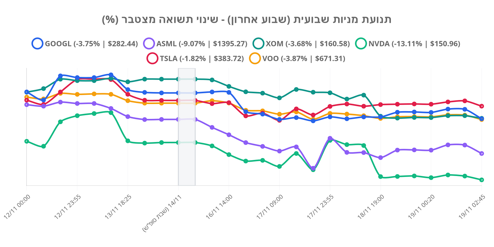

# 📈 Stock Tracker & Portfolio Analytics | מעקב תיק השקעות

> **מערכת חכמה לניהול ומעקב תיק השקעות בזמן אמת.**
> כוללת חישובי מס רווחי הון (25% ללא קיזוז הפסדים), המרות מט"ח דינמיות, יומן דיבידנדים היסטורי וניתוח ביצועים מתקדם.
> 👉 **[למעבר לדשבורד המלא והאינטראקטיבי לחץ כאן](https://almog787.github.io/My-new-stock-trucker/)**

---

## 📊 תמונת מצב (Executive Snapshot)

* **שווי תיק נוכחי:** `₪171,792` (`$51,563`)
* **רווח כולל נטו (לאחר 25% מס ללא קיזוז הפסדים):** `+₪19,871` (**+13.76%**)
* **שינוי יומי:** `+₪1,839` (**+1.08%**)
* **תוספת חודשית ממוצעת (YTD):** `-₪1,124/חודש` נטו
* **סך דיבידנדים (12M):** `₪740` נטו
* **מועד עדכון אחרון:** `27/11/2026 15:45` (שער ברוקר: `₪3.332`)

---

## 📋 ביצועי מניות והחזקות (Holdings Performance)

| נכס (Asset) | כמות | שער נוכחי | שווי שוק | שינוי יומי (Daily Change) | שינוי מהכניסה לתיק (Total Return) |
| :--- | :---: | :---: | :---: | :---: | :---: |
| **GOOGL**  Alphabet (Google) | 48 | $272.87 | ₪43,638  ($13,098) | 🔴 -0.08%  -₪37 | 🟢 +45.15%  +₪13,574 |
| **ASML**  ASML Holding | 4 | $1307.90 | ₪17,430  ($5,232) | 🟢 +0.37%  +₪64 | 🟢 +39.96%  +₪4,976 |
| **XOM**  Exxon Mobil | 2 | $161.08 | ₪1,073  ($322) | 🟢 +1.90%  +₪20 | 🟢 +27.76%  +₪233 |
| **NVDA**  NVIDIA Corp | 60 | $148.04 | ₪29,594  ($8,883) | 🔴 -0.84%  -₪251 | 🔴 -0.75%  -₪223 |
| **TSLA**  Tesla Inc | 20 | $400.62 | ₪26,695  ($8,012) | 🟢 +5.39%  +₪1,365 | 🔴 -8.21%  -₪2,387 |
| **VOO**  Vanguard S&P 500 | 24 | $667.34 | ₪53,361  ($16,016) | 🟢 +1.29%  +₪677 | 🟢 +26.54%  +₪11,192 |

---

## 📈 גרפים ומגמות (Visual Analytics)

### 📊 תנועת מניות התיק (שבועית ודו-שבועית כולל ציון סופי שבוע)
> **מעקב רציף אחר ביצועי כל מניות התיק בחתך שבועי (7 ימים) ודו-שבועי (14 ימים), עם ציון והדגשה ברורה של סופי השבוע (שבת וראשון שבהם המסחר סגור בבורסות ארה"ב).**

#### 🗓️ תנועת מניות שבועית (שבוע מסחר אחרון)

#### 📅 תנועת מניות דו-שבועית (14 ימי מסחר)

### 📊 ביצועי תיק והקצאת נכסים (30 יום)

 

> 💡 *לפירוט החזקות מלא, ניתוח תשואות חודשי, יומן דיבידנדים וגרפים אינטראקטיביים, יש להיכנס ל-[דשבורד המערכת](https://almog787.github.io/My-new-stock-trucker/).*

---
📂 *Portfolio Tracker & Analytics Engine by Almog787*
