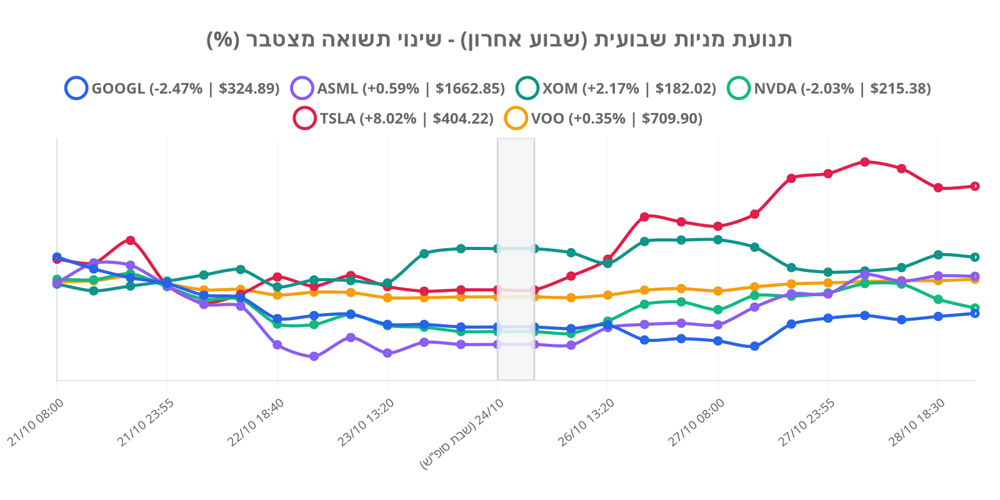
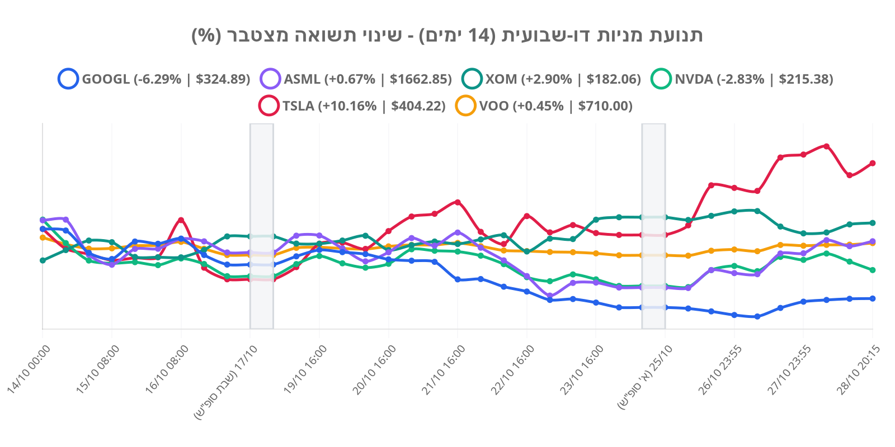
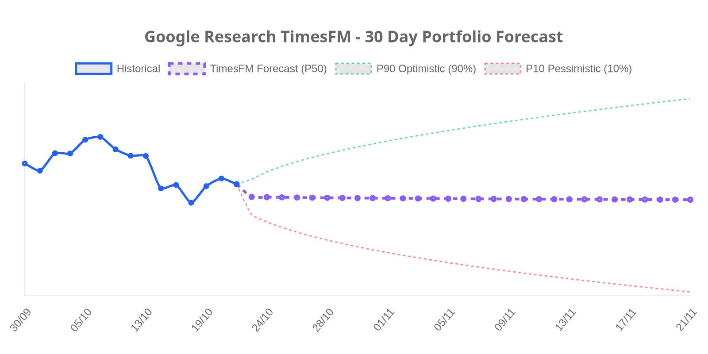
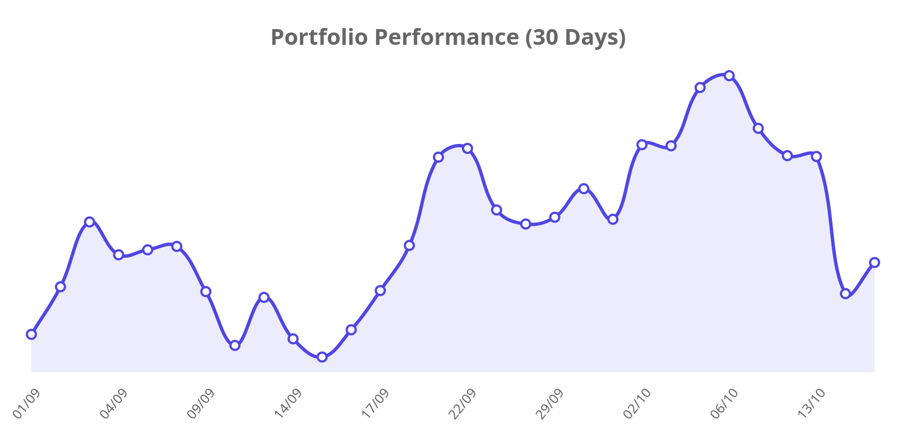
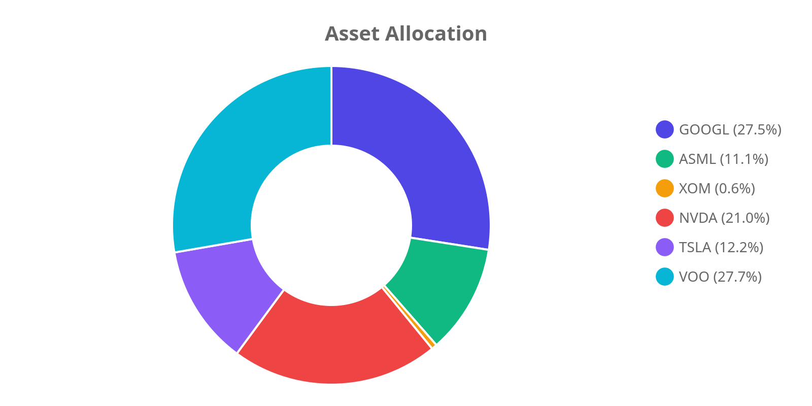

# 📈 Stock Tracker & Portfolio Analytics | מעקב תיק השקעות

> **מערכת חכמה לניהול ומעקב תיק השקעות בזמן אמת המשולבת במודל חיזוי סדרות עתיות Google Research TimesFM.** 
> כוללת חישובי מס רווחי הון (25%), המרות מט"ח, יומן דיבידנדים היסטורי, מנוע זיהוי אנומליות וחיזוי מבוסס AI.
> 👉 **[למעבר לדשבורד המלא והאינטראקטיבי לחץ כאן](https://almog787.github.io/My-new-stock-trucker/)**

---

## 📊 תמונת מצב (Executive Snapshot)

* **שווי תיק נוכחי:** `₪185,237` (`$59,411`)
* **רווח כולל נטו (לאחר 25% מס):** `+₪38,677` (**+28.93%**)
* **שינוי יומי:** `₪-3,081` (**-1.64%**)
* **הכנסה פאסיבית חודשית ממוצעת (YTD):** `+₪1,215/חודש` נטו
* **סך דיבידנדים (12M):** `₪687` נטו
* **מועד עדכון אחרון:** `16/10/2026 20:58` (שער רציף: `₪3.118`)

---

## 📋 ביצועי מניות והחזקות (Holdings Performance)

| נכס (Asset) | כמות | שער נוכחי | שווי שוק | שינוי יומי (Daily Change) | שינוי מהכניסה לתיק (Total Return) |
| :--- | :---: | :---: | :---: | :---: | :---: |
| **GOOGL**  Alphabet (Google) | 48 | $340.59 | ₪50,972  ($16,348) | 🔴 -2.47%  ₪-1,292 | 🟢 +81.17%  +₪22,838 |
| **ASML**  ASML Holding | 4 | $1641.52 | ₪20,472  ($6,566) | 🔴 -0.96%  ₪-199 | 🟢 +75.66%  +₪8,818 |
| **XOM**  Exxon Mobil | 2 | $178.98 | ₪1,116  ($358) | 🟢 +2.46%  +₪27 | 🟢 +41.96%  +₪330 |
| **NVDA**  NVIDIA Corp | 57 | $214.13 | ₪38,055  ($12,205) | 🔴 -1.43%  ₪-551 | 🟢 +44.08%  +₪11,642 |
| **TSLA**  Tesla Inc | 20 | $354.72 | ₪22,120  ($7,094) | 🔴 -2.13%  ₪-481 | 🔴 -18.73%  ₪-5,097 |
| **VOO**  Vanguard S&P 500 | 24 | $701.61 | ₪52,501  ($16,839) | 🔴 -1.10%  ₪-585 | 🟢 +33.04%  +₪13,038 |

---

## 🔮 תחזיות מודל Google Research TimesFM (AI Forecasting & Analytics)

* **יעד שווי תיק צפוי בעוד 30 יום (P50):** `₪188,468` (`$60,214`)
* **טווח הסתברותי (P10 - P90):** `₪156,082` עד `₪226,904`
* **תשואת תיק צפויה (30d Expected Return):** `+1.35%` (תנודתיות שנתית חזויה: `23.4%`)
* **תחזית שער דולר/שקל (30 יום):** `₪3.130` (טווח: `₪2.960 - ₪3.300`)

### 🎯 מטריצת תחזיות ואותות למניות התיק:
| מניה (Asset) | שער נוכחי | יעד צפוי 30 יום (P50) | טווח ביטחון (P10 - P90) | תשואה חזויה | אות מודל (AI Signal) |
| :--- | :---: | :---: | :---: | :---: | :---: |
| **GOOGL** | `$340.59` | `$341.34` | `$292.70 - $398.07` | **+0.22%** | 🟢 דשדוש / ניטרלי |
| **ASML** | `$1641.52` | `$1655.16` | `$1298.46 - $2109.85` | **+0.83%** | 🟢 מגמה חיובית מתונה |
| **XOM** | `$178.98` | `$184.83` | `$158.38 - $215.71` | **+3.27%** | 🟢 מגמה חיובית מתונה |
| **NVDA** | `$214.13` | `$219.41` | `$167.93 - $286.67` | **+2.47%** | 🟢 מגמה חיובית מתונה |
| **TSLA** | `$354.72` | `$368.38` | `$289.77 - $468.33` | **+3.85%** | 🟢 עלייה חזקה (Bullish) |
| **VOO** | `$701.61` | `$707.78` | `$652.83 - $767.34` | **+0.88%** | 🟢 מגמה חיובית מתונה |

---

## 📈 גרפים ומגמות (Visual Analytics)

### 📊 תנועת מניות התיק (שבועית ודו-שבועית כולל ציון סופי שבוע)
> **מעקב רציף אחר ביצועי כל מניות התיק בחתך שבועי (7 ימים) ודו-שבועי (14 ימים), עם ציון והדגשה ברורה של סופי השבוע (שבת וראשון שבהם המסחר סגור בבורסות ארה"ב).**

#### 🗓️ תנועת מניות שבועית (שבוע מסחר אחרון)

#### 📅 תנועת מניות דו-שבועית (14 ימי מסחר)

### 🔮 תחזית ביצועים והקצאת נכסים

 

 

> 💡 *לפירוט החזקות מלא, סימולטור תרחישים, זיהוי אנומליות וגרפים אינטראקטיביים, יש להיכנס ל-[דשבורד המערכת](https://almog787.github.io/My-new-stock-trucker/).*

---
📂 *Portfolio Tracker Engine & TimesFM AI Analytics by Almog787*
